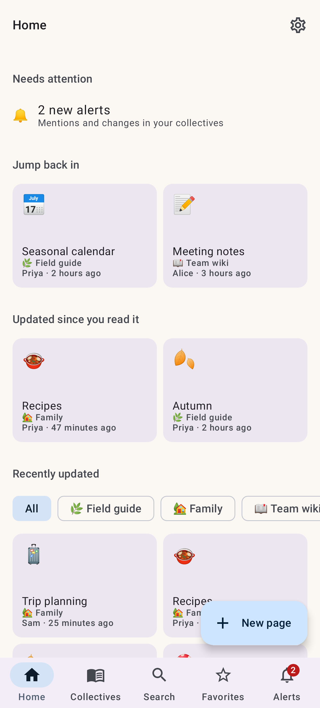
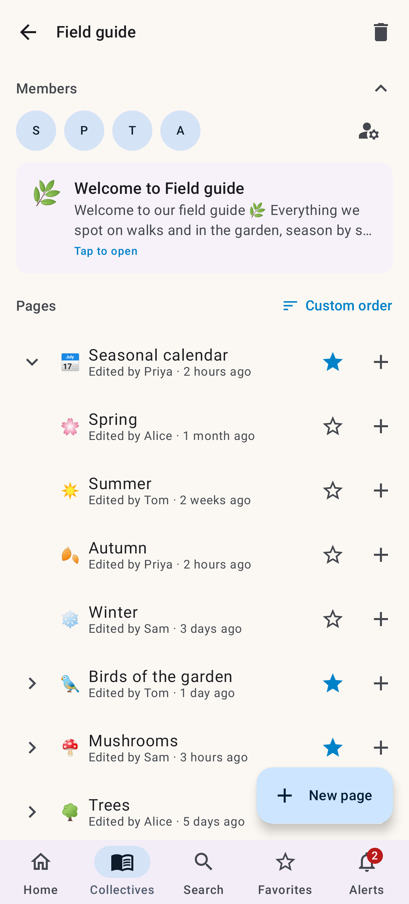
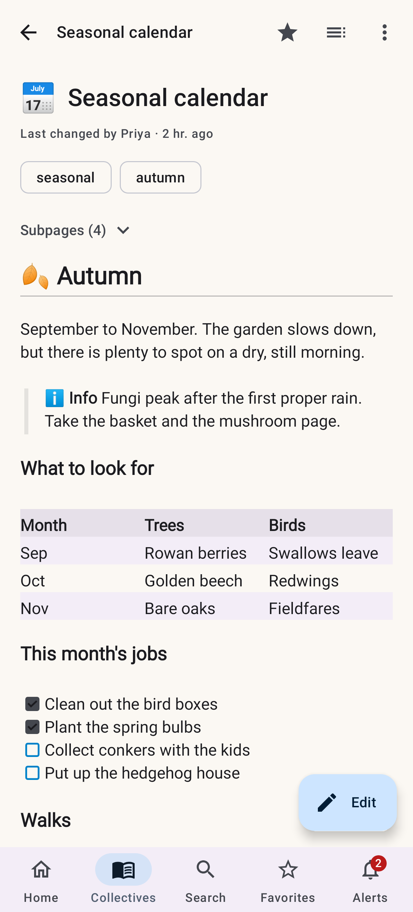
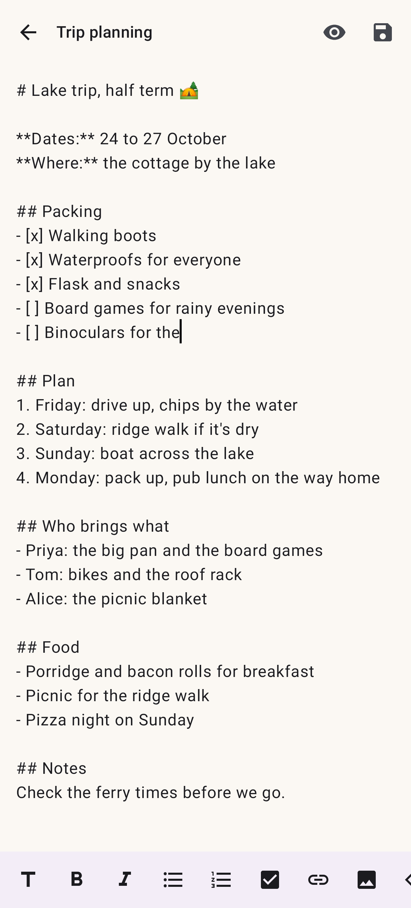
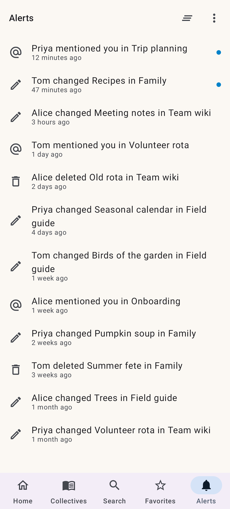
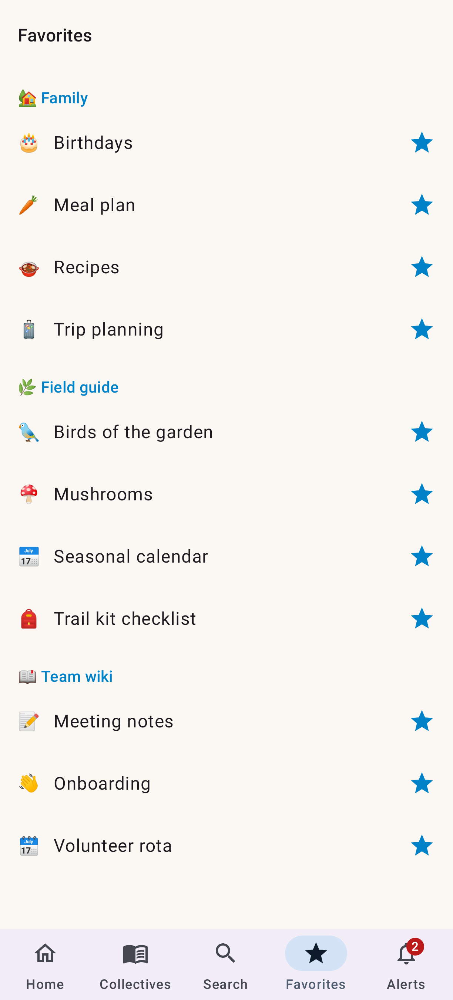

# NC Collectives — Android

An unofficial native Android client for the [Nextcloud Collectives](https://github.com/nextcloud/collectives) app — wiki-style markdown notebooks hosted on your own Nextcloud server.

> **100 % AI-written.** Every line of source, every test, every CI workflow, this README, and almost every commit message in this repository was written by [Claude Code](https://www.anthropic.com/claude-code) under direction from a human reviewer. No code in this repository was hand-typed.

> **Unofficial.** This project is not affiliated with, endorsed by, or supported by Nextcloud GmbH or the Nextcloud Collectives team. "Nextcloud" and "Collectives" are trademarks of their respective owners.

## Screenshots

The app's own screens, rendered with sample data.

<p align="center">
  
  
  
</p>
<p align="center">
  
  
  
</p>

## Features

- Five tabs — **Home**, **Collectives**, **Search**, **Favorites** and **Alerts** — each keeping its place, so leaving a tab and coming back finds you where you were. Tapping the tab you're on goes back to its first screen, then to the top (in Search, into the search field). Phones get a bottom navigation bar; wide screens get a navigation rail
- **Home**, from the local cache so it works offline: edits waiting to sync or in conflict and new alerts, then cards for the pages you opened recently, pages changed since you last read them, recently updated pages (filterable by collective) and your own recent edits, each with **See all** for the full list; and the tags across every collective. Its **New page** button picks a collective and a parent page. Settings is the cog in Home's top bar
- **Alerts**: mentions of you in collective pages, and changes to pages in collectives set to notify you, from the server's Notifications app. Open one to go to its page, or to its collective when the page was deleted; swipe it away, or dismiss them all, to clear them on the server too. Each collective's notification level (Off, Mentions or All) is set from the Alerts tab or the collective's menu. Alerts are in-app only: the tab's badge counts the new ones, and the app posts no system notifications
- Collectives and their nested page trees, each sorted A–Z, Z–A, or newest or oldest first by last change. Pages can also follow the custom order shared with the web app, chosen per collective; under it, long-press a page to drag it within its parent. **New collective** and, in a collective, **New page** are floating buttons
- Markdown rendering with images, links, task lists, tables, syntax-highlighted code blocks, Nextcloud Text callouts (`> [!INFO]` / `[!WARN]` / `[!ERROR]` / `[!SUCCESS]`) and `==text==` highlights. `[[Page Name]]` wikilinks and relative `.md` links open in the app. Each page lists its subpages, the pages that link to it, and its headings, which jump to their section
- View-first: a page's **Edit** button floats bottom-right, and the top and navigation bars slide away as you scroll down and come back as you scroll up. Two editors: a **native markdown editor** with a formatting toolbar and a preview, which works offline (the default), and a **collaborative editor** backed by [Nextcloud Text](https://github.com/nextcloud/text) (beta — real-time editing with others, plus everything Text supports) when the server offers it and you're online. Choose under **Settings → Editor**
- Offline reading and editing. Pages are cached, and edits made offline are queued. Each edit is sent against the version it was written from, and when the server reports that someone else changed the page meanwhile, your text is kept as a draft beside theirs and you choose which wins. Opening a page checks the server for a newer version
- Search across every collective through Nextcloud's unified search, filterable by collective, with recent searches and tags offered before you type
- **Favorites**, grouped by collective, each unstarred in place with an Undo
- Page tags, emoji, rename, move (folder pages included) and duplicate; trash and restore, with Undo. Create collectives, change their emoji, and trash, restore or delete them
- Attachments: inline images, and uploads from the camera or gallery
- Quick capture from any app's Share menu: text, links, or one or more images
- Several Nextcloud accounts, switched from **Settings → Accounts** without signing out. One account's pages are cached at a time: switching clears the previous account's copy and downloads the new one's, and warns first if any edits haven't reached the server yet
- Light, Dark or System theme, and a page text size (**Settings → Appearance**) that scales rendered pages and both editors on top of your device's font size
- Background sync every 1, 6 or 12 hours, daily, or never; pull to refresh; and **Sync now** in Settings, which says when sync last succeeded or why it failed

## Requirements

- Android 10 (API 29) or newer
- A Nextcloud instance with the [Collectives app](https://apps.nextcloud.com/apps/collectives) installed and accessible to your account, served over HTTPS

## Installing

### F-Droid (recommended)

[](https://f-droid.org/packages/com.megamaced.nccollectives/)

Install the [F-Droid client](https://f-droid.org), search for **NC Collectives** (`com.megamaced.nccollectives`), and install it from there. F-Droid then keeps the app up to date.

The listing is a **reproducible build**: F-Droid rebuilds the app from this repository at the release tag, checks that the result matches the APK signed with the developer's key, and distributes that signed APK. The F-Droid build and the GitHub release APK therefore carry the same signature, so a newer version from either installs over the other without uninstalling.

### APK from GitHub Releases

The same build F-Droid reproduces, for when you'd rather not run the F-Droid client or want a release before F-Droid has built it. Nothing updates it for you.

1. Download `app-release.apk` from the latest [release](https://github.com/megamaced/nc_collectives_android/releases).
2. Allow the browser or file manager you open it with to install apps (**Settings → Apps → Special app access → Install unknown apps**); Android usually asks the first time.
3. Open the APK to install it. A new version installs over the old one in place.

### Updates

F-Droid installs are updated by F-Droid. For a GitHub install, **Settings → About → Check for updates** asks GitHub for the latest release when you tap it, and opens its page if it's newer than yours. Nothing is checked at launch or in the background.

## Signing in

Open the app, enter your Nextcloud server's address (e.g. `https://cloud.example.com`), and approve the device in the browser tab that opens. This is Nextcloud's [Login Flow v2](https://docs.nextcloud.com/server/latest/developer_manual/client_apis/LoginFlow/index.html#login-flow-v2): the app only ever holds the device-scoped app password your server issues — never your account password — and you can revoke it at any time from your Nextcloud security settings.

## Privacy & security

- The app talks **only** to the Nextcloud server you configure. The one exception is the update check, which calls `api.github.com` when you tap **Check for updates**, on a separate HTTP client that never carries your Nextcloud credentials.
- No analytics, telemetry or crash reporting; no Google Play Services, Firebase or advertising IDs. The release APK contains no `com.google.android.gms` or `com.google.firebase` classes.
- It posts no system notifications, so it doesn't ask for the notification permission.
- Plain `http://` server addresses are refused, and cleartext traffic is disabled.
- The app password is stored in `EncryptedSharedPreferences` (Tink-backed). Signing out deletes it, along with every cached page and setting.
- Connections trust only the system certificate store, with no certificate pinning. A server whose certificate comes from a private or self-signed CA works only if that CA is in the system store; a CA installed as a user certificate is not trusted.

## Tech stack

- Kotlin + Jetpack Compose + Material 3 (single Activity, Compose Navigation)
- Hilt for dependency injection
- Retrofit + OkHttp + kotlinx.serialization (OCS REST and WebDAV over one authenticated OkHttp client)
- Room for the offline cache, edit queue and attachment upload queue
- WorkManager for background sync and for sending queued edits and uploads
- Coil for images, on the same authenticated OkHttp client
- Markwon for markdown rendering, with Prism4j for code highlighting, themed against the Material 3 colour scheme
- System `WebView` + `androidx.webkit` for the collaborative editor, through Nextcloud Text's `directEditing` endpoint
- Tink (`androidx.security:security-crypto`) for the encrypted credential store
- The system camera app, through a scoped FileProvider, for photos — no CAMERA permission

## Building

```bash
./gradlew assembleDebug
```

The debug APK lands at `app/build/outputs/apk/debug/app-debug.apk`.

`./gradlew assembleRelease` builds the release APK. Without the signing environment variables it is unsigned, at `app/build/outputs/apk/release/app-release-unsigned.apk`; [`docs/SIGNING.md`](docs/SIGNING.md) covers the keystore, the GitHub Actions secrets and the local variables.

Release builds are minified with R8 and reproducible: the same commit, built with the same toolchain and inputs, gives a byte-identical APK. That is what lets F-Droid match its rebuild to the signed release. A mirror of F-Droid's recipe is at [`docs/fdroid/com.megamaced.nccollectives.yml`](docs/fdroid/com.megamaced.nccollectives.yml).

## Contributing

Issues and pull requests welcome. For larger changes, please open an issue first.

## License

[AGPL-3.0-or-later](LICENSE) — same family as Nextcloud server and the Collectives app.
